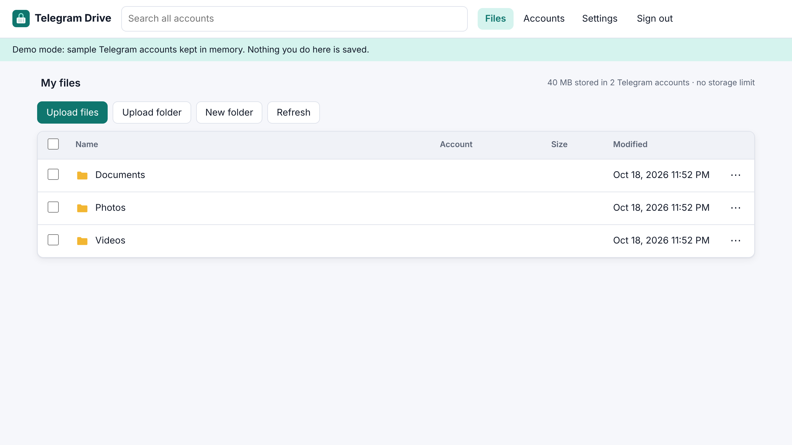
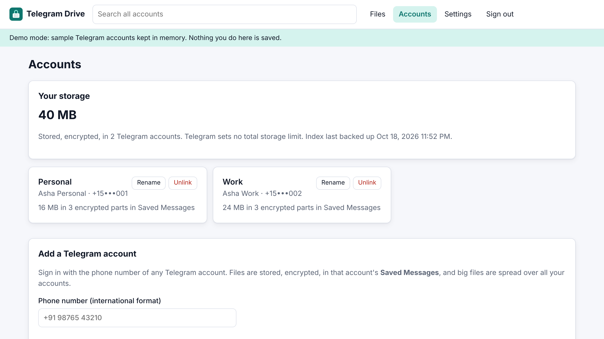
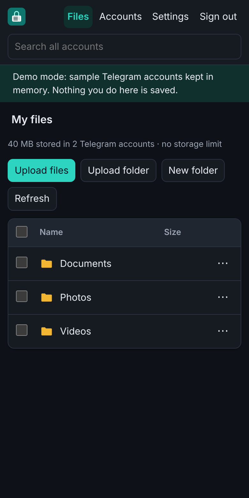
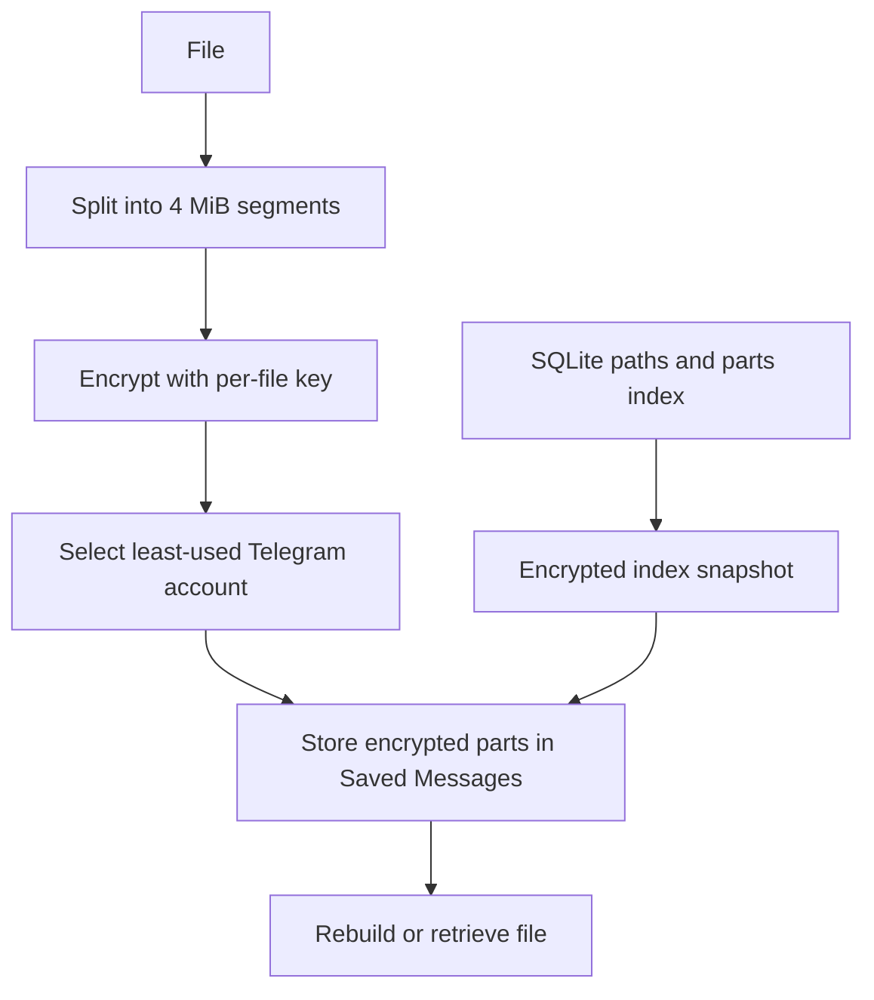

<div align="center">


# Telegram Drive

**Turn any number of Telegram accounts into one private, encrypted drive.**
Files go to each account's own *Saved Messages*. Open them from any browser, phone or computer.

[](https://github.com/Ethos6/free-telegram-drive/actions/workflows/ci.yml)
[](LICENSE)


</div>

> Telegram Drive is an independent open-source project. It is **not affiliated with, endorsed by or
> connected to Telegram**. Read [Things to know](#things-to-know) before you trust it with files.

<p align="center"></p>

## What it does

- **Web login of Telegram.** Add an account from the browser: phone number, the code Telegram
  sends you, and your two-step password if you have one. Add as many accounts as you like.
- **Your Saved Messages become storage.** Every file is uploaded as documents to the
  *Saved Messages* chat of your own accounts. Nothing is stored on anyone else's server.
- **End-to-end encrypted, always.** Files, names and folder structure are encrypted on your
  server (AES-256-GCM) before they reach Telegram. Telegram only sees random-looking `.bin` parts.
- **Big files and streaming.** Files are split into parts (256 MiB by default) and spread over
  your accounts, so there is no per-file size limit. Videos and audio stream with seeking; only
  the needed 4 MiB segments are fetched and decrypted.
- **One drive from many accounts.** Uploads go to the least-used account. Folders, search,
  move, copy (instant, no re-upload), share links with expiry, and folder upload.
- **Rebuild from Telegram.** An encrypted copy of the index is backed up to Saved Messages after
  every change. On a new server, enter your recovery key, link your accounts, press *Rebuild*,
  and your drive is back. Files uploaded after the last backup are recovered from their parts.
- **Network drive (WebDAV).** Mount it in Windows Explorer, macOS Finder, Linux file managers,
  rclone or phone apps. Passes 100% of the `litmus` WebDAV compliance suite.
- **Installable web app** for phones and desktops, light and dark theme.
- **Locked down.** Password with scrypt, optional two-factor login (TOTP), separate app
  passwords for WebDAV, CSRF protection, strict Content-Security-Policy, Telegram sessions
  encrypted at rest, phone numbers masked in the UI.

<p align="center">
  
  
</p>

## Try the demo (no Telegram needed)

```bash
pip install git+https://github.com/Ethos6/free-telegram-drive
tgdrive demo
```

Open <http://localhost:8080>, sign in with `demo-password`. The demo uses an in-memory stand-in for
Telegram with two sample accounts; link a third with phone `+1 555 0100` and code `12345`.

## Set it up for real

### 1. Get a Telegram API id (free, two minutes)

Telegram Drive signs in as a normal Telegram app, and every Telegram app needs an API id.

1. Go to <https://my.telegram.org> and log in with your phone number.
2. Open **API development tools** and create an app (any name, e.g. "My drive"; platform "Web").
3. Copy the **api_id** and **api_hash**. Keep the hash private.

### 2. Run it with Docker

```bash
git clone https://github.com/Ethos6/free-telegram-drive
cd free-telegram-drive
cp .env.example .env        # put your api_id and api_hash in it
docker compose up -d
docker compose logs | grep "setup code"
```

Or without Docker (Python 3.10+):

```bash
pip install git+https://github.com/Ethos6/free-telegram-drive
export TELEGRAM_API_ID=123456 TELEGRAM_API_HASH=your_hash
tgdrive serve --port 8080
```

### 3. First start

1. Open the app and enter the **setup code** from the server log, then choose a password.
2. **Create the vault** and save the **recovery key** it shows you (14 groups of 4 characters)
   in a password manager. **Without it, nobody can decrypt your files** if the server is lost.
3. **Link Telegram accounts** under *Accounts*. Add one or many.
4. Upload files. Optional: turn on two-factor login and create a WebDAV app password in *Settings*.

### Use it from anywhere

To reach your drive from outside your home network, put it behind HTTPS. For example, with Caddy:

```
drive.example.com {
    reverse_proxy 127.0.0.1:8080
}
```

Then set `TGDRIVE_BASE_URL=https://drive.example.com` and `TGDRIVE_TRUST_PROXY=1`. A Cloudflare
Tunnel or Tailscale also work if you do not want to open a port.

### Mount it as a drive

Create an app password in *Settings → Use it as a drive (WebDAV)*, then connect to `https://your-host/dav/`:

| System | How |
| --- | --- |
| Windows | Explorer → *This PC* → *Map network drive* → `https://your-host/dav/` |
| macOS | Finder → *Go* → *Connect to Server* → `https://your-host/dav/` |
| Linux | Files → *Other Locations* → `davs://your-host/dav/` |
| rclone | `rclone config` → WebDAV, vendor *Other*, user anything, password = app password |

## Settings

| Variable | Default | Meaning |
| --- | --- | --- |
| `TELEGRAM_API_ID`, `TELEGRAM_API_HASH` | – | From my.telegram.org. Required to link real accounts. |
| `TGDRIVE_BASE_URL` | `http://localhost:8080` | Public address, used in share links and WebDAV info. |
| `TGDRIVE_DATA` | `./data` | Where the index database and keys live. Back this folder up. |
| `TGDRIVE_SECRET_KEY` | generated in `data/secret.key` | Encrypts sessions and the master key at rest. |
| `TGDRIVE_TRUST_PROXY` | off | Set `1` behind a reverse proxy so client IPs and HTTPS are seen. |
| `TGDRIVE_CHUNK_MB` | `256` | Part size, 16–1900 MiB. Telegram's per-file limit is 2 GB (4 GB with Premium). |
| `TGDRIVE_PARALLEL` | `3` | Parts uploaded at the same time, 1–8. |

Forgot the password? `tgdrive set-password` on the server (add `--reset-2fa` to also turn off 2FA).

## How it works

```
your file ──► split into parts ──► AES-256-GCM, 4 MiB segments ──► upload to Saved Messages
                 (256 MiB)          per-file key (HKDF)              of the least-used account
                                    encrypted caption                     │
SQLite index (paths → parts) ──► encrypted snapshot ─────────────────────┘
```



- Each vault has one 256-bit **master key**, shown once as the recovery key. Each file gets its own
  key derived with HKDF from the master key and a random content id.
- Parts are sealed in 4 MiB segments, each with its own nonce and with the file id, part number and
  segment number bound as associated data, so parts and segments cannot be swapped, reordered or
  cut short without detection. Seeking in a video only downloads the segments it needs.
- Each part's caption is an encrypted record of which file it belongs to. That is what lets
  *Rebuild* recover files even if the newest index backup is missing.
- Copies share the same parts. Parts are deleted from Telegram only when no file uses them.

## Things to know

Please read these honestly before relying on it.

- **Telegram's rules apply.** You are using your own accounts through Telegram's official API.
  Telegram's [Terms of Service](https://telegram.org/tos) and
  [API Terms](https://core.telegram.org/api/terms) apply. Telegram can rate-limit, restrict or ban
  accounts it considers abusive, and it can change its storage policies at any time. "Unlimited"
  means Telegram sets no total storage limit today, not a promise. Do not use this for anything
  illegal, and do not keep the only copy of irreplaceable files anywhere, including here.
- **Speed.** Telegram decides how fast you can upload and download; accounts without Premium can be
  slower. More accounts let uploads run in parallel.
- **Keep three things safe:** the recovery key, the `data` folder (or at least `secret.key`), and
  access to your Telegram accounts. With the recovery key and the accounts, you can always rebuild.
- **Do not delete the `.bin` messages** in Saved Messages by hand; those are your files.
- **Signing in** adds a session named "Telegram Drive" under *Telegram → Settings → Devices*.
  Ending that session there unlinks the account. Your Telegram two-step password is passed to
  Telegram once and never stored.
- **Who can read what:** Telegram sees encrypted parts, their sizes and upload times. Whoever runs
  the server sees everything, so run it yourself or on a machine you trust.

## Development

```bash
pip install -e ".[dev]"
pytest -q                       # 68 tests, no network needed
tgdrive demo --port 8080        # UI with a fake Telegram
```

The Telegram layer is a small interface (`tgdrive/telegram.py`); `tgdrive/fake.py` implements it
in memory for tests and the demo. Contributions are welcome; please open an issue first for big
changes. Security reports: see [SECURITY.md](SECURITY.md).

## License

[MIT](LICENSE). Telegram is a trademark of its owners; this project only uses the public API.
